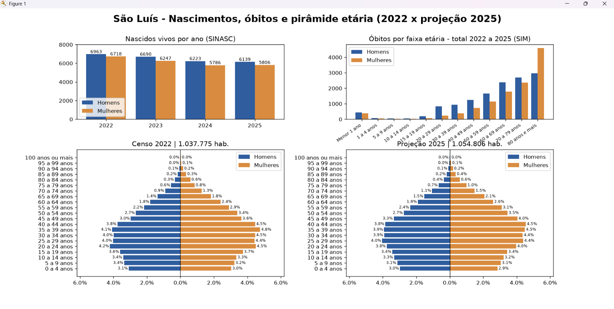

# 📊 Projeção da Pirâmide Etária de São Luís - MA (2022 → 2025)

Projeto de análise demográfica feito com **dados reais e públicos** do **IBGE** e do **DATASUS**. Ele junta economia e dados para estimar como está a população de São Luís hoje.



---

## 🎯 Objetivo

O último Censo é de 2022. A partir dele, e dos nascimentos e óbitos registrados de 2022 a 2025, este projeto **projeta a pirâmide etária de São Luís para 2025** e analisa as mudanças na estrutura da população.

---

## 🗂️ Fontes dos dados

Todos os dados são **reais e públicos**.

| Dado | Fonte | Como foi coletado |
|---|---|---|
| População por idade e sexo (Censo 2022) | IBGE / SIDRA, tabela 9514 | Pela **API do IBGE**, direto no Python (`requests`), com resposta em JSON |
| Nascidos vivos por ano e sexo (2022 a 2025) | DATASUS / SINASC | Pelo site do **TabNet**, porque o DATASUS não tem uma API simples |
| Óbitos por faixa etária e sexo (2022 a 2025) | DATASUS / SIM | Pelo site do **TabNet** |

Filtros usados no DATASUS: município **211130 São Luís**, por residência (da mãe, nos nascimentos, e do falecido, nos óbitos).

---

## ⚙️ Como a projeção foi feita

1. **Coleta do Censo:** o código chama a API do IBGE e monta um DataFrame com a população de São Luís por faixa de 5 anos e sexo.
2. **Idades simples:** cada faixa de 5 anos é dividida igualmente entre as idades dela.
3. **Taxa de mortalidade:** os óbitos de 2022 a 2025 são divididos por 4 (média anual) e depois pela população de cada idade e sexo.
4. **Envelhecimento:** a população de 2022 ganha 3 anos, e em cada ano sai a parte que morre, conforme a taxa.
5. **Nascimentos:** os bebês nascidos em 2023, 2024 e 2025 entram na base da pirâmide, com 2, 1 e 0 anos.
6. **Reagrupamento:** tudo volta para faixas de 5 anos para comparar 2022 com 2025.

---

## 💡 Principais resultados

- **População:** de **1.037.775** habitantes (Censo 2022) para cerca de **1.054.806** em 2025 (projeção), um aumento de **≈ 1,6%**.
- **Queda nos nascimentos:** de **13.690** em 2022 para **11.950** em 2025, cerca de **13% a menos**. A base da pirâmide (0 a 4 anos) está encolhendo.
- **Nascem mais homens, mas morrem mais homens**, principalmente entre 15 e 39 anos. Entre 20 e 29 anos, foram **840 óbitos de homens** contra **227 de mulheres**.
- **As mulheres chegam em maior número aos 80 anos ou mais.**
- **Envelhecimento:** as faixas a partir dos 60 anos ganham participação. Na faixa de 60 a 64 anos, os homens passam de 1,8% para 1,9% da população, e as mulheres de 2,4% para 2,6%.

**Leitura econômica:** com menos nascimentos e mais idosos, menos gente vai entrar no mercado de trabalho nos próximos anos, o que aumenta a pressão sobre a previdência, a saúde e o planejamento da cidade.

---

## 🛠️ Tecnologias

- **Python**
- **requests**: consome a API do IBGE.
- **Pandas**: organiza os dados em DataFrames, calcula as taxas e agrupa as faixas etárias.
- **Matplotlib**: monta o dashboard com as pirâmides e os gráficos de barras.
- **re** e **io**: extraem os números dos textos das faixas e leem os dados do DATASUS.


---

## ▶️ Como rodar

```bash
pip install requests pandas matplotlib
py piramide_sao_luis.py
```

O script baixa os dados do Censo pela API, mostra no terminal a população de 2022, a projetada para 2025 e a variação, e salva o dashboard em `dashboard_sao_luis.png`.

---

## ⚠️ Limitações

- A projeção **não considera migração** (quem se mudou para São Luís ou saiu da cidade).
- Os dados do DATASUS de **2025 são preliminares** (extração de 28/07/2026).
- Dentro de cada faixa de 5 anos, a população foi distribuída **igualmente** entre as idades.
- A taxa de mortalidade é a **mesma** nos três anos projetados. Por isso, a projeção mostra o envelhecimento da população, mas não mede mudanças na expectativa de vida.

---

## 👩‍💻 Autora

**Brenda Carmosa**
Estudante de Ciências Econômicas e de Inteligência de Mercado e Análise de Dados

[LinkedIn](https://www.linkedin.com/in/brenda-carmosa-30208b361/) · [GitHub](https://github.com/brendacarmosa-create)
